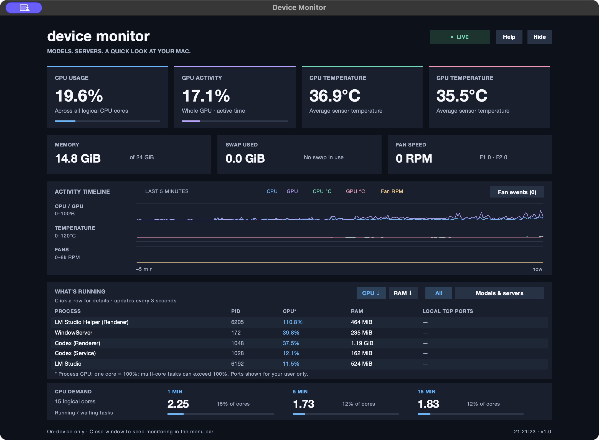
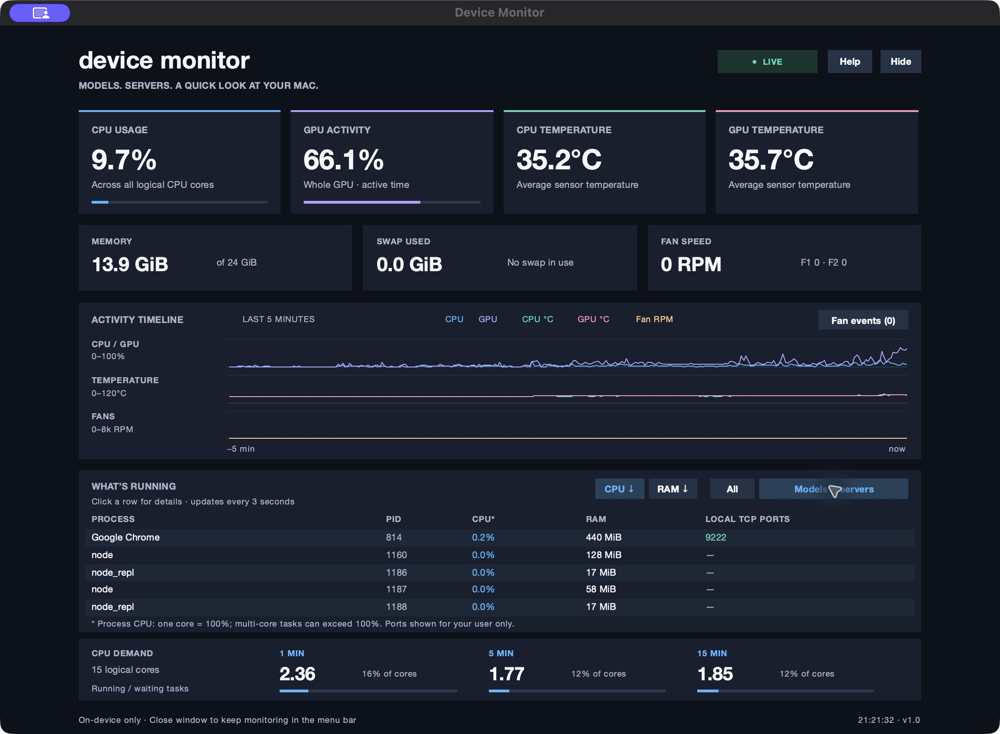

# Device Monitor 1.0

A small, free Apple Silicon Mac monitor for the local models and development
servers you leave running. Built in Python with a modern Metro-style interface.

[Download Device Monitor 1.0 for Apple Silicon](https://github.com/holygenius/device-monitor/releases/tag/v1.0)



## Models and servers

Filter the process list to spot model runtimes and local servers, with listening
ports shown when accessible.



## Features

- CPU usage and GPU active time, CPU/GPU temperatures, RAM, swap, and fan RPM.
- A shared five-minute timeline with separate activity, temperature, and RPM lanes.
- Fan-rise markers and snapshots of the top CPU process around each event.
- Process names, PIDs, CPU, resident RAM, and listening TCP ports visible to your user.
- CPU/RAM sorting, a Models & servers filter, and click-through process details.
- Native menu-bar readings and compact summary; hide/reopen the dashboard.
- Automatic recovery from startup timeouts, stalled readers, and sleep/wake.
- Explicit 1 / 5 / 15-minute load readings compared with logical core count.

Fan events help correlate changes in time. They do not diagnose which process
caused a fan rise. The filter recognizes runtime names and listening ports; it
does not identify exact model names or inspect process arguments.

## Install

Download `Device-Monitor-1.0-Apple-Silicon.dmg` from the repository's Releases,
open it, drag the app to Applications, and eject the image.

This build is **ad-hoc signed, not Apple notarized**. If macOS blocks the first
launch, try opening the app once, then use **System Settings > Privacy & Security
> Open Anyway**, and confirm Open, only if you trust this download.
[Apple's instructions](https://support.apple.com/102445).
Managed Macs may prevent this exception. No global security changes are needed.

Apple Silicon only. The build targets macOS 11+ and has been tested on macOS
26.6.1. Older releases and other Mac models need further testing. Python and
dependencies are bundled; no Python installation is required for the app.

## Use

Close or hide the dashboard to keep the menu-bar monitor running. Click its
CPU/temperature text for compact readings and Show dashboard or Quit.
**Quit Device Monitor / Command-Q** stops monitoring and all readers.
Use Help for units and interpretation. Use View > Reconnect sensors to retry.

## Privacy

No accounts, analytics, network requests, or saved monitoring history.
Process lists, the five-minute timeline, and fan events stay in memory until quit.
Arguments and environment variables are not collected. Process executable paths
are shown only in the details window, and a project folder basename is resolved
on demand when accessible. Local port scans are restricted to the current user.

## Run or build from source

Use an Apple Silicon Python 3.12 with working modern Tk support. Apple's old
system Tk may render a blank window. A uv-managed Python 3.12 with Tk 9 works
on the tested system.

```sh
python3.12 -m venv .venv
.venv/bin/python -m pip install -r build-requirements.txt
.venv/bin/python device_monitor.py
```

Keep the bundled `macmon` beside the source. To build a self-contained app and DMG:

```sh
.venv/bin/python build_release.py
```

Outputs: `dist/Device Monitor.app` and `Device-Monitor-1.0-Apple-Silicon.dmg`.
Default builds use an ad-hoc signature. See `PUBLIC-RELEASE.md` for optional
Developer ID signing and notarization.

## Checks

```sh
.venv/bin/python -m unittest discover -s tests -v
.venv/bin/python device_monitor.py --self-test /tmp/device-monitor-check.json
```

Checks cover parsing, fan-event behavior, a real local server's process/port,
sensor reconnection and timeouts, shutdown, menu-bar show/hide, and layout at
three sizes. Testing was performed locally on the system listed above.

## License and credits

MIT License. Hardware readings use [macmon 0.10.0](https://github.com/vladkens/macmon).
Python, Tcl/Tk, PyObjC, and macmon dependency notices are included; see
`THIRD-PARTY-NOTICES.txt` and the app's bundled `licenses` directory.
